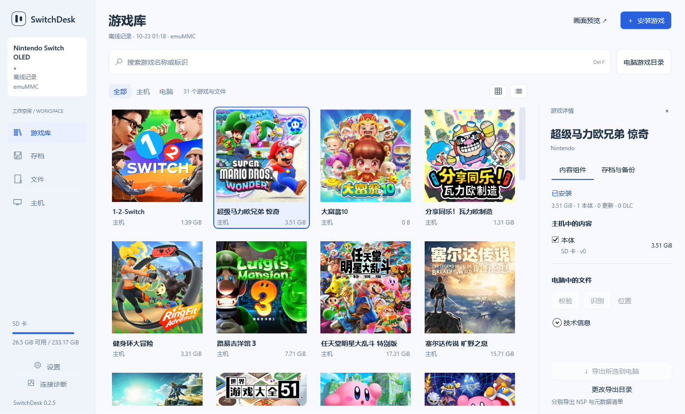

  
  <h1>SwitchDesk</h1>
  
<strong>Manage your Switch games, saves and SD files.</strong>

  
A game, console-save and SD-file manager for Atmosphère-enabled Nintendo Switch consoles. Runs on Windows.

  
<a href="https://github.com/Humboldt-Zh/SwitchDesk/releases/tag/v0.2.5-preview">Download preview</a> · <a href="docs/INSTALL.md">Get started</a> · <a href="docs/STATUS.md">Test status</a> · <a href="docs/BUILD.md">Build</a> · <a href="README.md">简体中文</a>

  
   

Use a Windows PC and USB to manage games, saves and SD files on your Switch. Browse console content, back up Switch saves to the PC, and access file-transfer and restore tools. The local library organizes installation packages and exported content.

> **Development preview:** Windows **0.2.5**, Switch companion **0.2.4**, protocol **1**. Startup, controls and USB inventory reads have been checked on one OLED console. See [validation records](docs/STATUS.md) and [known issues](docs/KNOWN-ISSUES.md).

<picture>
  <source media="(prefers-color-scheme: dark)" srcset="docs/images/library-dark.png">
  
</picture>

*Actual SwitchDesk 0.2.5 WPF UI showing real games and cover icons previously read from a console. This capture uses the existing offline cache and preserves its original sync timestamp; it is not an OS screenshot of a live USB session. Console identity is hidden and account/save details are omitted. The current application UI and detailed documentation are in Simplified Chinese.*

## Features

- **Console overview:** model, firmware, Atmosphère, environment and storage. emuMMC user storage is identified explicitly.
- **A unified library:** search console games and PC packages, switch between grid and list views, and inspect base/update/installed DLC components. Unknown packages remain unidentified until parsed.
- **Switch save tools:** back up saves belonging to console games/users to the PC, with ZIP snapshots with manifests and hashes, history, deduplication, connection-triggered backups, pre-restore recovery copies and Explorer drag-out support.
- **Content transfers:** SD file browsing and bidirectional transfers, protected paths, batch installation review and component-based export.
- **A focused workspace:** light/dark/system themes, keyboard controls and timestamped offline records. Task history lives in diagnostics.
- **Streaming entry point:** launch a separately installed official SysDVR client. Follow the upstream setup instructions for the separate client.

Save writeback is **not atomic across power loss**. Read the [known issues](docs/KNOWN-ISSUES.md) and keep an independent recovery copy.

## Can it update Switch games?

Local game update (Patch) packages are processed through the existing USB installation entry point as a development-preview feature. Supply a matching update package yourself and use the existing installation entry point. Automatic online update discovery/download is not implemented. Packages must match the base game and target system. See [update scope and source review](docs/GAME-UPDATES.md).

## Get started

You need Windows x64, a first-generation Switch already running Atmosphère, and a USB data cable. The tested PC runs Windows 11. Unmodified retail firmware cannot run the companion NRO.

1. Download the Windows and Switch packages from this repository's **[Releases](https://github.com/Humboldt-Zh/SwitchDesk/releases/tag/v0.2.5-preview)**, and check `SHA256SUMS.txt`. The Windows package includes the .NET runtime.
2. Copy the NRO to `/switch/SwitchDesk/SwitchDesk.nro` and launch it in **full application mode**.
3. Connect USB and run `SwitchDesk.exe`. If detection fails, use Connection Diagnostics to inspect WinUSB binding and the **SwitchDesk PC** product name.

See the [installation guide](docs/INSTALL.md) for driver details and updates. Local library browsing and file verification are available without a console.

## Validation and development

As of **2026-10-23**, local checks include 70 automated tests, a 500-item UI fixture, and WPF render checks for light/dark themes at three window widths and two render scales. These are not physical monitor-DPI tests.

The tested hardware baseline is OLED / HOS 20.4.0 / Atmosphère 1.9.4 / emuMMC / full application mode. Companion 0.2.4 startup, X/B controls, reopening and one USB inventory read passed. This does not establish compatibility with every model or firmware.

The desktop uses C# / WPF / .NET 10; the companion uses C++ / libnx and pinned Sphaira sources. Build instructions and roadmap: [Build](docs/BUILD.md) · [Protocol](docs/PROTOCOL.md) · [Roadmap](docs/ROADMAP.md) · [Contributing](CONTRIBUTING.md). Remote GitHub Actions has not yet been run.

## Credits and license

The Switch companion extends [Sphaira 1.0.8](https://github.com/NaGaa95/sphaira), including its installation, export, save and USB code. Thanks to [libnx](https://github.com/switchbrew/libnx), [Atmosphère](https://github.com/Atmosphere-NX/Atmosphere), [.NET / WPF](https://github.com/dotnet/wpf) and their contributors. [SysDVR](https://github.com/exelix11/SysDVR) is launched as an external process and is not bundled.

Licensed under **[GPL-3.0](LICENSE)**; see [third-party notices](THIRD-PARTY-NOTICES.md). Binary releases must include matching corresponding source. No games, firmware, console keys, account data or private saves are included. This project is not affiliated with Nintendo.
