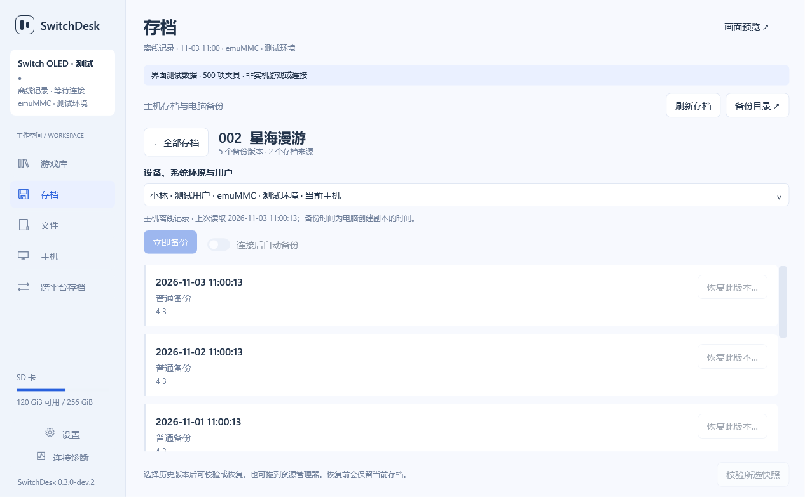
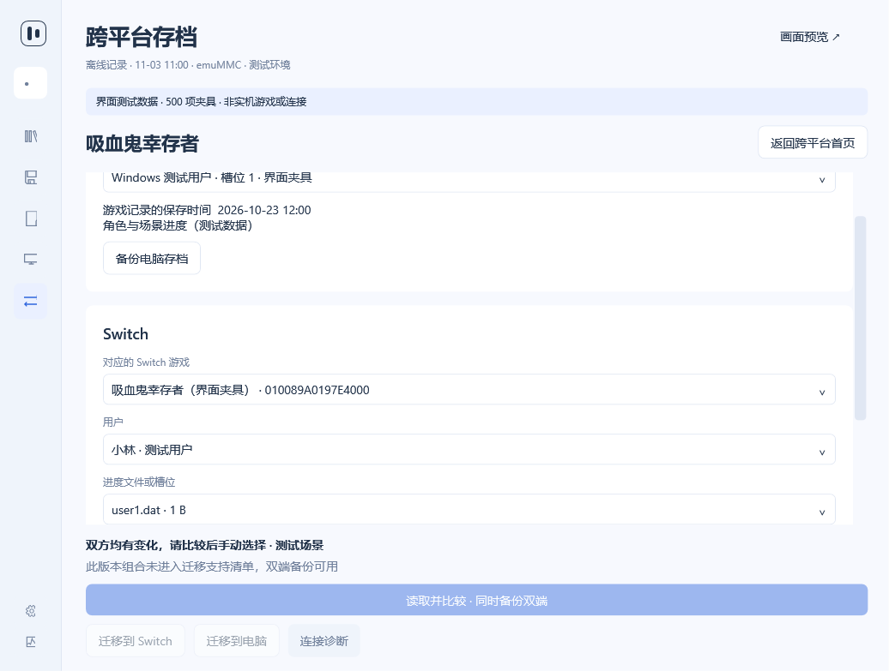

# 四项实测问题修复记录

日期：2026-11-03。Windows / Switch 配套本地开发版本 **0.3.0-dev.2**，统一来源 **`bc5abe181644`**；协议 1、存档 ZIP 格式 1。仅本地交付，未发布新 Release、未部署到主机。

## 修复结果

1. **导出所选到电脑**：上游 NSP 导出会在头部、NCA、票据和证书边界正常返回短段，服务端之前只调用一次读取便要求读满整个协议块。现在只在导出分支累计这些正常短段，读满后再响应；零进展、越界、异常长度和底层错误仍拒绝，普通文件／存档的严格长度检查保持。修复位于配套 NRO，仅更新 Windows 不能修复旧配套。
2. **跨平台文件选择**：选定游戏与用户后，自动通过现有只读接口发现文件并关闭句柄。单文件自动选择，多文件手动选择，然后一次比较完成双端备份。空目录、超限、未知格式、Applet 和读取失败均有明确状态。切用户、设备、环境或断线时清理旧预览；迟到的响应不能填回新用户。
3. **正式跨平台入口**：侧栏增加“跨平台存档”（Alt+5），独立六款首页和详情，保留游戏详情直达。游戏／用户／文件选择不再借用游戏库状态，不会把任意游戏默认配成吸血鬼。当前只有吸血鬼幸存者与死亡细胞的 Switch 游戏标识已核实；其他四款显示识别待补，可发现与独立备份电脑存档。发现登记不等于迁移准入，迁移清单仍为空。
4. **存档库与时间线**：独立数据源汇总主机存档记录与电脑已有 Switch ZIP，搜索／来源筛选不再依赖电脑安装包。点击游戏进入主区域时间线，按设备、系统环境、游戏、用户及存档类型隔离；所有来源的历史可浏览，缓存明确标为离线。恢复仍需完整身份匹配，已有 ZIP 不搬动、不改写；普通备份去重与保留策略、Recovery 不自动清理的规则保留。扫描失败有摘要，列出清单不代表已校验存档内容。

## 电脑与目标构建验证

- Windows x64，.NET SDK **10.0.402**：构建零警告、零错误，**145 项测试通过、0 失败**。本次新增 6 项存档库、9 项跨平台发现和 2 项导出失败／取消测试；完整 WPF 命令测试同步覆盖真实首次发现、A→B→A 用户切换迟到响应、一次比较、身份保护、离线和重连。
- **72 张 WPF 渲染图通过**：浅／深色，1050／1280／1920 DIP，96／192 DPI 渲染比例及最小窗口高度，覆盖正式首页、文件选择和完整时间线；无 WPF 绑定错误。已人工查看时间线、六款首页及实际显示所选文件的渲染图。渲染比例检查不等于真实显示器 DPI 切换。
- 真实本地目录只读核对：**6 份可读取清单、5 款游戏、6 个来源、6 个时间线版本**。电脑备份筛选仍显示全部 5 款；身份错配、离线误判在线和扫描错误均为 0。只读取清单，未读取 payload、未访问 USB，原文件元数据未变化。
- 电脑 Linux / QEMU 的原生 **ASan／UBSan 三组检查通过**（native、argv、management）；补强 64 位断言后，最终 native 源码再次通过。覆盖分段逐字节核对、头／内容边界、尾块、超过 4 GiB 的偏移、零进展、底层错误及虚报长度。管理视图使用绘图桩，不能当作 Horizon 服务或 Switch 界面验证。
- devkitA64 GCC **16.1.0**：配套编译、链接和 NRO 打包通过。Windows 与 NRO 的来源标识一致。

本机原始检查输出在被忽略的 `work/field-fixes-20261103` 与 `work/export-fix-20261103`，不包含在公开源码包中。初次回归发现的“共享历史来源抢在实时用户前默认选中”问题已修复，最终 145 项结果包含对应检查。

## 二进制与后续真机验收

- Windows `SwitchDesk.exe` SHA-256：`73A024DF931B770489A77F42F9722E790C8EB003478AAD60EC24EF8D252CADCF`。
- Switch `SwitchDesk.nro` SHA-256：`A28DEC64C96FD753796FEE2F585CEF6463921A1D77A323FA46E97F10B8B858CE`。
- 完整来源 SHA-256：`bc5abe181644c41463e6387ec0766a527aa72b88291030594508432e2a6fd08a`。

退出旧电脑端和主机配套后，使用同一开发包的 Windows 与 NRO；NRO 手动替换位置为 `switch/SwitchDesk/SwitchDesk.nro`。本轮没有自动部署或任何真实主机写回。

**真实导出待验收**：以完整应用模式连接，先导出截图中的本体，核对完整长度、NSP 可解析与清单摘要；再按现有样本验更新／DLC和大于 4 GiB 的组件。不需要为导出修复重新安装游戏。Explorer 交互、物理断线和真实 DPI 切换仍按现场条件分别记录。迁移与原生隐藏不因本次修复解禁。

## 界面示例

以下均为明确标记的合成夹具，非真实主机截图或游戏兼容证据。

